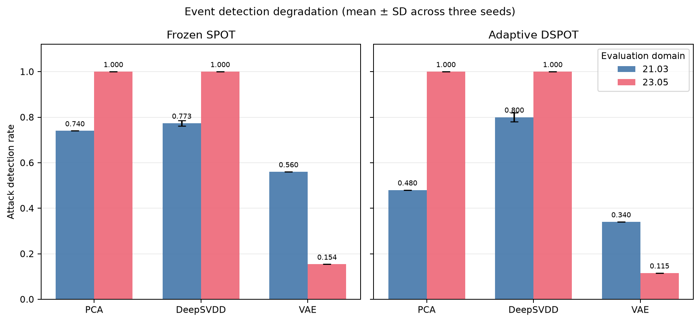
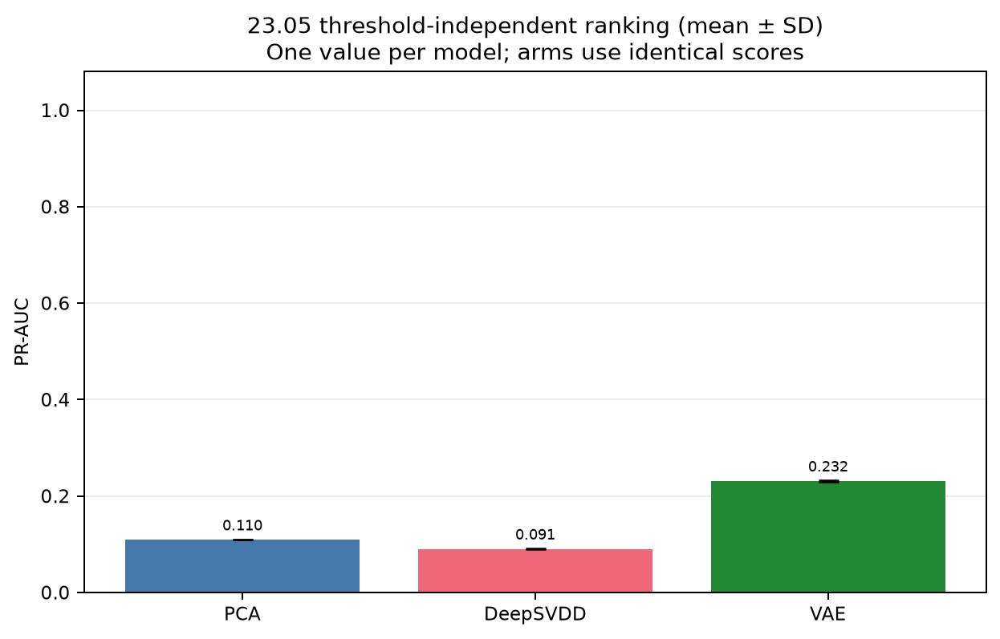
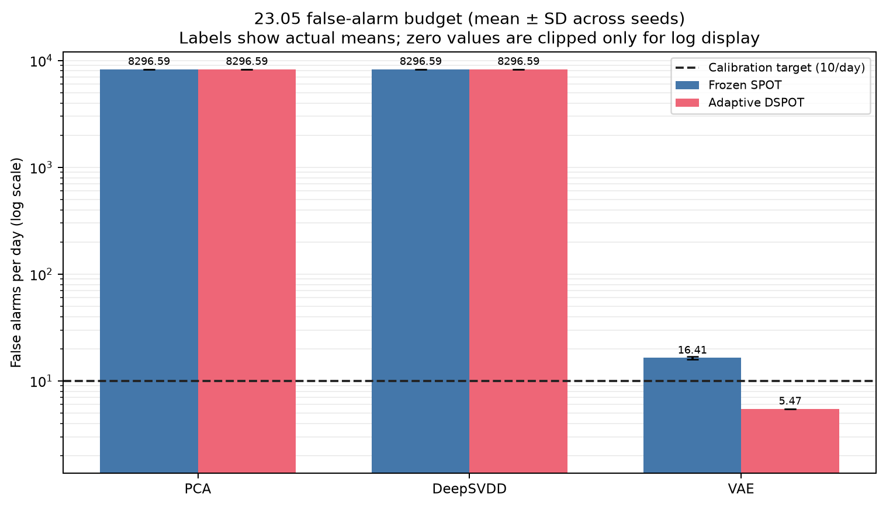
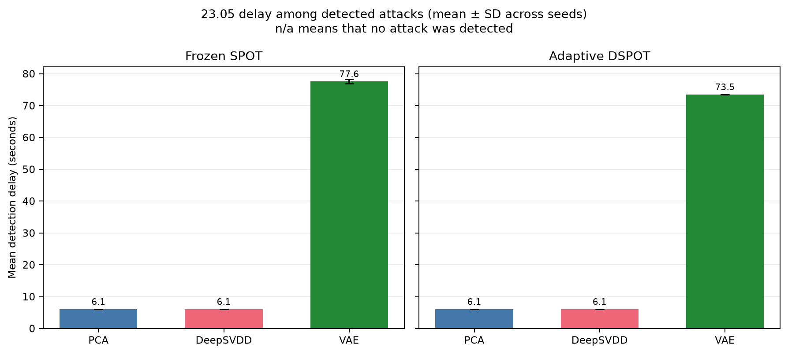
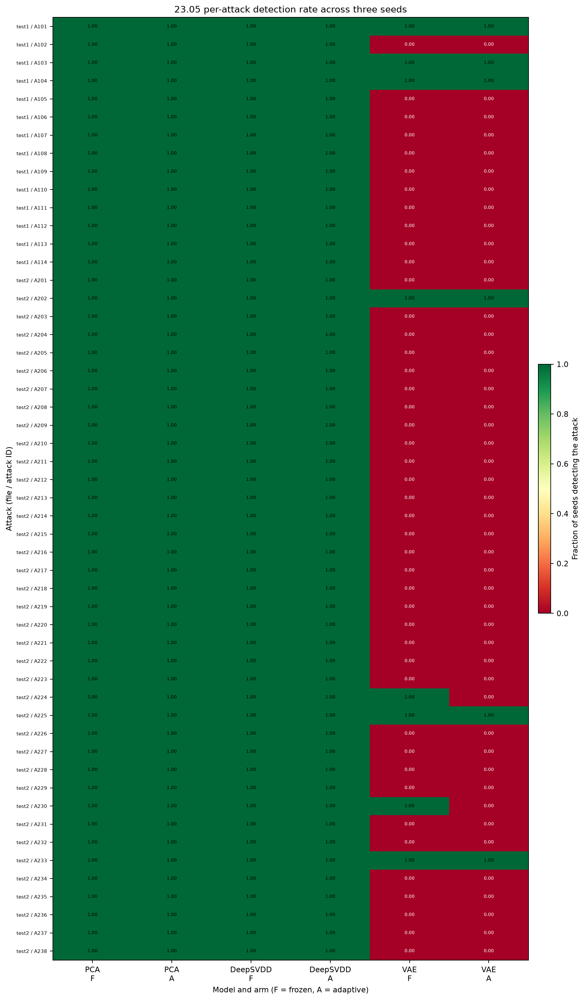
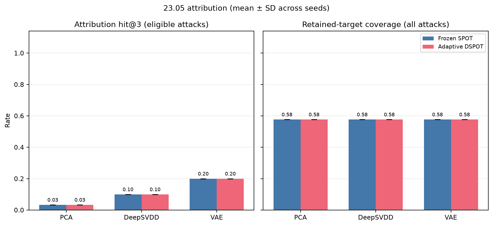

# Zero-Day Anomaly Detection under HAI Plant-Version Shift

**A three-seed, source-only evaluation of PCA, DeepSVDD, and a convolutional VAE with frozen and adaptive EVT decisions**

Hongbin Zhang and Zeren Wang — Project Group 88, SSY340 Deep Machine Learning

## Abstract

This study evaluates zero-day anomaly detection on the HAI dataset. Its 59-tag public intersection is filtered using source-only variance to 41 nonconstant modeling sensors. The corpus contains 1,608,008 real telemetry rows and 102 documented attack events, including 52 in the held-out 23.05 domain. Models are trained only on normal 21.03 data and evaluated over three seeds (11, 23, 37). VAE achieved the highest mean 23.05 PR-AUC (0.232 ± 0.002). Frozen and adaptive PR-AUC are identical because both arms threshold the same continuous scores. For VAE, frozen event recall moved from 0.560 on 21.03 to 0.154 on 23.05; DSPOT changed cross-domain recall to 0.115 (gain -0.038; recovery ROM -0.095) and false alarms from 16.41 to 5.47 per day. DSPOT is interpreted strictly as decision-layer adaptation: it changes thresholds, not the learned representation.

## Research Questions

- **RQ1 — Degradation:** How much do event detection, eTaPR F1, and point F1 degrade from 21.03 to 23.05 when the source threshold is frozen?
- **RQ2 — Recovery:** How much of that loss does source-calibrated DSPOT recover on 23.05, and at what observed false-alarm rate?
- **RQ3 — Ranking versus decisions:** Do threshold-independent ranking metrics support the same conclusions as thresholded event metrics?
- **RQ4 — Attribution:** How often do the top 3 anomalous sensors include a documented target retained in the source-nonconstant modeling schema?

## Data and Experimental Protocol

| Partition | Files | Rows | Duration (days at 1 Hz) | Attack events |
| --- | --- | --- | --- | --- |
| 21.03 normal training | 3 | 921,603 | 10.667 | 0 |
| 21.03 test | 5 | 402,005 | 4.653 | 50 |
| 23.05 test | 2 | 284,400 | 3.292 | 52 |
| All streams | 10 | 1,608,008 | 18.611 | 102 |

The processed corpus comprises 1,608,008 one-hertz rows (18.611 stream-days). There are 50 attacks in 21.03 test and 52 in 23.05 test, for 102 total. The two plant versions share 59 public tags, but 18 have zero variance throughout the normal 21.03 training partitions. Their constant source encoding can dominate max-fused scores after plant-version shift. They are therefore removed using source-training variance alone, leaving 41 source-nonconstant modeling tags. Durations are computed from the actual per-file row counts in `data/processed/metadata.json`, rather than rounded summary values.

The three official 21.03 training files contain 921,603 rows, equivalent to 256.0 hours at 1 Hz. This measured duration differs from the 352 hours stated in HAI v4.0 documentation. All data accounting here follows the actual file row counts and per-file SHA-256 hashes recorded in metadata, not the copied documentation duration.

Normalization statistics are fitted only on chronological 21.03 training partitions. The last 15% of each normal source stream is reserved from model fitting and supplies normal calibration scores. No 23.05 labels, attack intervals, thresholds, or model updates are used during training or calibration. Evaluation replays each stream chronologically and separately for every model, seed, domain, and arm.

## Methods

### Shared windowing and model family

Each score is aligned to the causal end of a 60-second window; evaluation windows use a 10-second stride, while non-overlapping training windows use a 60-second stride. No future samples enter a window. DeepSVDD and the VAE use a matched three-layer, bias-free one-dimensional convolutional trunk and the same latent width. This architectural matching does not imply equal total parameter counts: the VAE additionally requires Gaussian heads and a decoder. DeepSVDD learns a latent hypersphere and scores squared distance to its fixed center. The standard VAE optimizes reconstruction plus KL divergence and scores reconstruction error using the mean latent at evaluation. The PCA baseline reconstructs flattened multivariate windows and derives per-sensor reconstruction errors. Per-sensor scores are fused by the configured maximum, so a system alarm requires only one strongly anomalous sensor.

| Model | Seeds | Parameters | Epochs | Training seconds (mean ± SD) |
| --- | --- | --- | --- | --- |
| PCA | 11, 23, 37 | n/a | n/a | 1.32 ± 0.08 |
| DeepSVDD | 11, 23, 37 | 13904 | 40 | 18.84 ± 1.23 |
| VAE | 11, 23, 37 | 26352 | 40 | 45.35 ± 1.76 |

Parameter counts are read from each run's training metadata and show the actual SVDD/VAE capacity difference; PCA does not have a comparable neural parameter count. Training times are descriptive measurements, not controlled speed benchmarks.

### EVT calibration and deployment arms

Both EVT arms are calibrated exclusively on normal 21.03 scores to an empirical target of 10 alarms/day. The initial threshold uses quantile 0.98, at least 20 exceedances, and 4000 initialization samples where available. The frozen arm deploys SPOT with its source-fitted terminal threshold. The adaptive arm deploys DSPOT with the same source calibration, then updates the decision threshold during chronological replay. DSPOT uses depth 360 and updates every 25 scored samples. **The EVT risk q is calibrated separately for frozen SPOT and adaptive DSPOT for every model and seed.** The observed calibration rate is an empirical selection criterion, not a guarantee of the shifted-domain false-alarm rate.

| Model | Seed | Arm | q | Observed alarms/day | Target/day | Source threshold |
| --- | --- | --- | --- | --- | --- | --- |
| PCA | 11 | Frozen SPOT | 0.000184447 | 9.671 | 10.000 | 14.5997 |
| PCA | 11 | Adaptive DSPOT | 9.48091e-05 | 8.792 | 10.000 | 18.0041 |
| PCA | 23 | Frozen SPOT | 0.000184447 | 9.671 | 10.000 | 14.6003 |
| PCA | 23 | Adaptive DSPOT | 9.48091e-05 | 8.792 | 10.000 | 18.004 |
| PCA | 37 | Frozen SPOT | 0.000184447 | 9.671 | 10.000 | 14.602 |
| PCA | 37 | Adaptive DSPOT | 9.48091e-05 | 8.792 | 10.000 | 18.0021 |
| DeepSVDD | 11 | Frozen SPOT | 0.00115741 | 10.551 | 10.000 | 1.42578 |
| DeepSVDD | 11 | Adaptive DSPOT | 0.00135811 | 8.792 | 10.000 | 1.38867 |
| DeepSVDD | 23 | Frozen SPOT | 0.00115741 | 7.913 | 10.000 | 1.44257 |
| DeepSVDD | 23 | Adaptive DSPOT | 0.00135811 | 7.913 | 10.000 | 1.27142 |
| DeepSVDD | 37 | Frozen SPOT | 0.00115741 | 14.947 | 10.000 | 1.97261 |
| DeepSVDD | 37 | Adaptive DSPOT | 0.00115741 | 11.430 | 10.000 | 1.29119 |
| VAE | 11 | Frozen SPOT | 4.87336e-05 | 10.551 | 10.000 | 37.3626 |
| VAE | 11 | Adaptive DSPOT | 9.48091e-05 | 10.551 | 10.000 | 27.2134 |
| VAE | 23 | Frozen SPOT | 4.87336e-05 | 10.551 | 10.000 | 35.6255 |
| VAE | 23 | Adaptive DSPOT | 9.48091e-05 | 10.551 | 10.000 | 27.3127 |
| VAE | 37 | Frozen SPOT | 4.87336e-05 | 10.551 | 10.000 | 35.7991 |
| VAE | 37 | Adaptive DSPOT | 9.48091e-05 | 10.551 | 10.000 | 27.2083 |

### Metrics and attribution

PR-AUC and ROC-AUC are computed from continuous scores and are threshold-independent. Point precision, recall, and F1 use raw thresholded points with **no point adjustment**. eTaPR uses theta_p = 0.5 and theta_r = 0.1; event detection recall counts an attack as detected when at least one alarm occurs within its documented interval. Detection delay is measured from event start to the first in-event alarm and is summarized only over detected attacks. False alarms are alarms on normal points, normalized by the actual evaluated stream-days.

**eTaPR is the enhanced time-series-aware metric published at SAC 2022 [7], not the CIKM 2019 TaPR metric [6].** TaPR and eTaPR are distinct; this report does not relabel either citation or use point adjustment, whose optimistic bias is discussed by Kim et al. [8].

Attribution averages per-sensor scores over each attack interval and ranks sensors. Hit@3 is true when any retained documented target appears in the top 3. A retained target is the intersection of attack documentation with the 41-tag source-nonconstant modeling schema; target coverage is computed against this same schema. **If that intersection is empty, the attack is excluded from the attribution-hit denominator and is not counted as an attribution failure.** Target coverage is reported separately so this eligibility restriction remains visible.

## Results

### Three-seed aggregate results

Entries are mean ± sample standard deviation across the three seeds. Event recall is the documented-attack detection rate; FA/day is the false-alarm rate.

| Model | Domain | Arm | Event recall | eTa F1 | Point F1 | PR-AUC | FA/day | Hit@3 |
| --- | --- | --- | --- | --- | --- | --- | --- | --- |
| PCA | 21.03 | Frozen | 0.740 ± 0.000 | 0.533 ± 0.000 | 0.548 ± 0.000 | 0.502 ± 0.000 | 30.11 ± 0.00 | 0.229 ± 0.000 |
| PCA | 21.03 | Adaptive | 0.480 ± 0.000 | 0.386 ± 0.000 | 0.370 ± 0.000 | 0.502 ± 0.000 | 18.93 ± 0.00 | 0.229 ± 0.000 |
| PCA | 23.05 | Frozen | 1.000 ± 0.000 | 0.000 ± 0.000 | 0.076 ± 0.000 | 0.110 ± 0.000 | 8296.59 ± 0.00 | 0.033 ± 0.000 |
| PCA | 23.05 | Adaptive | 1.000 ± 0.000 | 0.000 ± 0.000 | 0.076 ± 0.000 | 0.110 ± 0.000 | 8296.59 ± 0.00 | 0.033 ± 0.000 |
| DeepSVDD | 21.03 | Frozen | 0.773 ± 0.012 | 0.543 ± 0.027 | 0.622 ± 0.009 | 0.489 ± 0.002 | 66.02 ± 11.06 | 0.171 ± 0.029 |
| DeepSVDD | 21.03 | Adaptive | 0.800 ± 0.020 | 0.527 ± 0.020 | 0.614 ± 0.007 | 0.489 ± 0.002 | 76.99 ± 4.96 | 0.171 ± 0.029 |
| DeepSVDD | 23.05 | Frozen | 1.000 ± 0.000 | 0.000 ± 0.000 | 0.076 ± 0.000 | 0.091 ± 0.001 | 8296.59 ± 0.00 | 0.100 ± 0.000 |
| DeepSVDD | 23.05 | Adaptive | 1.000 ± 0.000 | 0.000 ± 0.000 | 0.076 ± 0.000 | 0.091 ± 0.001 | 8296.59 ± 0.00 | 0.100 ± 0.000 |
| VAE | 21.03 | Frozen | 0.560 ± 0.000 | 0.473 ± 0.002 | 0.313 ± 0.005 | 0.462 ± 0.001 | 18.28 ± 0.00 | 0.257 ± 0.000 |
| VAE | 21.03 | Adaptive | 0.340 ± 0.000 | 0.313 ± 0.010 | 0.222 ± 0.005 | 0.462 ± 0.001 | 14.48 ± 0.33 | 0.257 ± 0.000 |
| VAE | 23.05 | Frozen | 0.154 ± 0.000 | 0.104 ± 0.001 | 0.217 ± 0.001 | 0.232 ± 0.002 | 16.41 ± 0.53 | 0.200 ± 0.000 |
| VAE | 23.05 | Adaptive | 0.115 ± 0.000 | 0.095 ± 0.000 | 0.088 ± 0.002 | 0.232 ± 0.002 | 5.47 ± 0.00 | 0.200 ± 0.000 |



### Complete run-level results

The following tables include every model, seed, domain, and arm. No run is hidden behind the aggregate summary.

#### Event detection and eTaPR

| Model | Seed | Domain | Arm | Detected | Event recall | eTa P | eTa R | eTa F1 | eTa det. R |
| --- | --- | --- | --- | --- | --- | --- | --- | --- | --- |
| PCA | 11 | 21.03 | Frozen | 37/50 | 0.740 | 0.671 | 0.442 | 0.533 | 0.560 |
| PCA | 11 | 21.03 | Adaptive | 24/50 | 0.480 | 0.671 | 0.270 | 0.386 | 0.360 |
| PCA | 11 | 23.05 | Frozen | 52/52 | 1.000 | 0.000 | 0.000 | 0.000 | 0.000 |
| PCA | 11 | 23.05 | Adaptive | 52/52 | 1.000 | 0.000 | 0.000 | 0.000 | 0.000 |
| PCA | 23 | 21.03 | Frozen | 37/50 | 0.740 | 0.671 | 0.442 | 0.533 | 0.560 |
| PCA | 23 | 21.03 | Adaptive | 24/50 | 0.480 | 0.671 | 0.270 | 0.386 | 0.360 |
| PCA | 23 | 23.05 | Frozen | 52/52 | 1.000 | 0.000 | 0.000 | 0.000 | 0.000 |
| PCA | 23 | 23.05 | Adaptive | 52/52 | 1.000 | 0.000 | 0.000 | 0.000 | 0.000 |
| PCA | 37 | 21.03 | Frozen | 37/50 | 0.740 | 0.671 | 0.442 | 0.533 | 0.560 |
| PCA | 37 | 21.03 | Adaptive | 24/50 | 0.480 | 0.671 | 0.270 | 0.386 | 0.360 |
| PCA | 37 | 23.05 | Frozen | 52/52 | 1.000 | 0.000 | 0.000 | 0.000 | 0.000 |
| PCA | 37 | 23.05 | Adaptive | 52/52 | 1.000 | 0.000 | 0.000 | 0.000 | 0.000 |
| DeepSVDD | 11 | 21.03 | Frozen | 39/50 | 0.780 | 0.522 | 0.552 | 0.537 | 0.620 |
| DeepSVDD | 11 | 21.03 | Adaptive | 40/50 | 0.800 | 0.522 | 0.551 | 0.536 | 0.620 |
| DeepSVDD | 11 | 23.05 | Frozen | 52/52 | 1.000 | 0.000 | 0.000 | 0.000 | 0.000 |
| DeepSVDD | 11 | 23.05 | Adaptive | 52/52 | 1.000 | 0.000 | 0.000 | 0.000 | 0.000 |
| DeepSVDD | 23 | 21.03 | Frozen | 39/50 | 0.780 | 0.485 | 0.561 | 0.520 | 0.620 |
| DeepSVDD | 23 | 21.03 | Adaptive | 39/50 | 0.780 | 0.491 | 0.601 | 0.540 | 0.680 |
| DeepSVDD | 23 | 23.05 | Frozen | 52/52 | 1.000 | 0.000 | 0.000 | 0.000 | 0.000 |
| DeepSVDD | 23 | 23.05 | Adaptive | 52/52 | 1.000 | 0.000 | 0.000 | 0.000 | 0.000 |
| DeepSVDD | 37 | 21.03 | Frozen | 38/50 | 0.760 | 0.606 | 0.541 | 0.572 | 0.620 |
| DeepSVDD | 37 | 21.03 | Adaptive | 41/50 | 0.820 | 0.468 | 0.544 | 0.504 | 0.620 |
| DeepSVDD | 37 | 23.05 | Frozen | 52/52 | 1.000 | 0.000 | 0.000 | 0.000 | 0.000 |
| DeepSVDD | 37 | 23.05 | Adaptive | 52/52 | 1.000 | 0.000 | 0.000 | 0.000 | 0.000 |
| VAE | 11 | 21.03 | Frozen | 28/50 | 0.560 | 0.684 | 0.359 | 0.471 | 0.520 |
| VAE | 11 | 21.03 | Adaptive | 17/50 | 0.340 | 0.585 | 0.203 | 0.302 | 0.280 |
| VAE | 11 | 23.05 | Frozen | 8/52 | 0.154 | 0.596 | 0.057 | 0.103 | 0.077 |
| VAE | 11 | 23.05 | Adaptive | 6/52 | 0.115 | 0.636 | 0.051 | 0.095 | 0.077 |
| VAE | 23 | 21.03 | Frozen | 28/50 | 0.560 | 0.684 | 0.362 | 0.473 | 0.520 |
| VAE | 23 | 21.03 | Adaptive | 17/50 | 0.340 | 0.601 | 0.215 | 0.317 | 0.300 |
| VAE | 23 | 23.05 | Frozen | 8/52 | 0.154 | 0.577 | 0.057 | 0.105 | 0.077 |
| VAE | 23 | 23.05 | Adaptive | 6/52 | 0.115 | 0.620 | 0.051 | 0.094 | 0.077 |
| VAE | 37 | 21.03 | Frozen | 28/50 | 0.560 | 0.688 | 0.361 | 0.474 | 0.520 |
| VAE | 37 | 21.03 | Adaptive | 17/50 | 0.340 | 0.609 | 0.217 | 0.320 | 0.300 |
| VAE | 37 | 23.05 | Frozen | 8/52 | 0.154 | 0.576 | 0.057 | 0.103 | 0.077 |
| VAE | 37 | 23.05 | Adaptive | 6/52 | 0.115 | 0.643 | 0.051 | 0.095 | 0.077 |

#### Point-wise and threshold-independent metrics

| Model | Seed | Domain | Arm | Point P | Point R | Point F1 | PR-AUC | ROC-AUC |
| --- | --- | --- | --- | --- | --- | --- | --- | --- |
| PCA | 11 | 21.03 | Frozen | 0.735 | 0.436 | 0.548 | 0.502 | 0.867 |
| PCA | 11 | 21.03 | Adaptive | 0.716 | 0.250 | 0.370 | 0.502 | 0.867 |
| PCA | 11 | 23.05 | Frozen | 0.040 | 1.000 | 0.076 | 0.110 | 0.499 |
| PCA | 11 | 23.05 | Adaptive | 0.040 | 1.000 | 0.076 | 0.110 | 0.499 |
| PCA | 23 | 21.03 | Frozen | 0.735 | 0.436 | 0.548 | 0.502 | 0.867 |
| PCA | 23 | 21.03 | Adaptive | 0.716 | 0.250 | 0.370 | 0.502 | 0.867 |
| PCA | 23 | 23.05 | Frozen | 0.040 | 1.000 | 0.076 | 0.110 | 0.499 |
| PCA | 23 | 23.05 | Adaptive | 0.040 | 1.000 | 0.076 | 0.110 | 0.499 |
| PCA | 37 | 21.03 | Frozen | 0.735 | 0.436 | 0.548 | 0.502 | 0.867 |
| PCA | 37 | 21.03 | Adaptive | 0.716 | 0.250 | 0.370 | 0.502 | 0.867 |
| PCA | 37 | 23.05 | Frozen | 0.040 | 1.000 | 0.076 | 0.110 | 0.499 |
| PCA | 37 | 23.05 | Adaptive | 0.040 | 1.000 | 0.076 | 0.110 | 0.499 |
| DeepSVDD | 11 | 21.03 | Frozen | 0.626 | 0.613 | 0.620 | 0.488 | 0.846 |
| DeepSVDD | 11 | 21.03 | Adaptive | 0.623 | 0.622 | 0.623 | 0.488 | 0.846 |
| DeepSVDD | 11 | 23.05 | Frozen | 0.040 | 1.000 | 0.076 | 0.090 | 0.429 |
| DeepSVDD | 11 | 23.05 | Adaptive | 0.040 | 1.000 | 0.076 | 0.090 | 0.429 |
| DeepSVDD | 23 | 21.03 | Frozen | 0.612 | 0.616 | 0.614 | 0.491 | 0.851 |
| DeepSVDD | 23 | 21.03 | Adaptive | 0.594 | 0.625 | 0.609 | 0.491 | 0.851 |
| DeepSVDD | 23 | 23.05 | Frozen | 0.040 | 1.000 | 0.076 | 0.090 | 0.436 |
| DeepSVDD | 23 | 23.05 | Adaptive | 0.040 | 1.000 | 0.076 | 0.090 | 0.436 |
| DeepSVDD | 37 | 21.03 | Frozen | 0.678 | 0.591 | 0.631 | 0.488 | 0.848 |
| DeepSVDD | 37 | 21.03 | Adaptive | 0.604 | 0.618 | 0.611 | 0.488 | 0.848 |
| DeepSVDD | 37 | 23.05 | Frozen | 0.040 | 1.000 | 0.076 | 0.091 | 0.428 |
| DeepSVDD | 37 | 23.05 | Adaptive | 0.040 | 1.000 | 0.076 | 0.091 | 0.428 |
| VAE | 11 | 21.03 | Frozen | 0.676 | 0.199 | 0.308 | 0.461 | 0.871 |
| VAE | 11 | 21.03 | Adaptive | 0.639 | 0.137 | 0.226 | 0.461 | 0.871 |
| VAE | 11 | 23.05 | Frozen | 0.733 | 0.127 | 0.216 | 0.230 | 0.607 |
| VAE | 11 | 23.05 | Adaptive | 0.746 | 0.047 | 0.088 | 0.230 | 0.607 |
| VAE | 23 | 21.03 | Frozen | 0.683 | 0.206 | 0.316 | 0.461 | 0.871 |
| VAE | 23 | 21.03 | Adaptive | 0.637 | 0.130 | 0.217 | 0.461 | 0.871 |
| VAE | 23 | 23.05 | Frozen | 0.725 | 0.128 | 0.218 | 0.233 | 0.643 |
| VAE | 23 | 23.05 | Adaptive | 0.743 | 0.046 | 0.087 | 0.233 | 0.643 |
| VAE | 37 | 21.03 | Frozen | 0.682 | 0.205 | 0.315 | 0.463 | 0.871 |
| VAE | 37 | 21.03 | Adaptive | 0.642 | 0.135 | 0.223 | 0.463 | 0.871 |
| VAE | 37 | 23.05 | Frozen | 0.724 | 0.127 | 0.217 | 0.232 | 0.645 |
| VAE | 37 | 23.05 | Adaptive | 0.750 | 0.048 | 0.090 | 0.232 | 0.645 |



The PR-AUC figure intentionally has one bar per model rather than duplicate frozen/adaptive bars. Both arms consume exactly the same continuous anomaly scores; only their thresholds and resulting decisions differ. Consequently their PR-AUC and ROC-AUC values are identical for a given model, seed, and domain.

#### Alarm budget, delay, and attribution

| Model | Seed | Domain | Arm | Alarms | False alarms | FA/day | Days | Mean delay (s) | Median delay (s) | Target coverage | Hit@3 |
| --- | --- | --- | --- | --- | --- | --- | --- | --- | --- | --- | --- |
| PCA | 11 | 21.03 | Frozen | 528 | 140 | 30.11 | 4.650 | 49.4 | 39.0 | 0.700 | 0.229 |
| PCA | 11 | 21.03 | Adaptive | 310 | 88 | 18.93 | 4.650 | 55.8 | 46.0 | 0.700 | 0.229 |
| PCA | 11 | 23.05 | Frozen | 28430 | 27300 | 8296.59 | 3.291 | 6.1 | 6.5 | 0.577 | 0.033 |
| PCA | 11 | 23.05 | Adaptive | 28430 | 27300 | 8296.59 | 3.291 | 6.1 | 6.5 | 0.577 | 0.033 |
| PCA | 23 | 21.03 | Frozen | 528 | 140 | 30.11 | 4.650 | 49.4 | 39.0 | 0.700 | 0.229 |
| PCA | 23 | 21.03 | Adaptive | 310 | 88 | 18.93 | 4.650 | 55.8 | 46.0 | 0.700 | 0.229 |
| PCA | 23 | 23.05 | Frozen | 28430 | 27300 | 8296.59 | 3.291 | 6.1 | 6.5 | 0.577 | 0.033 |
| PCA | 23 | 23.05 | Adaptive | 28430 | 27300 | 8296.59 | 3.291 | 6.1 | 6.5 | 0.577 | 0.033 |
| PCA | 37 | 21.03 | Frozen | 528 | 140 | 30.11 | 4.650 | 49.4 | 39.0 | 0.700 | 0.229 |
| PCA | 37 | 21.03 | Adaptive | 310 | 88 | 18.93 | 4.650 | 55.8 | 46.0 | 0.700 | 0.229 |
| PCA | 37 | 23.05 | Frozen | 28430 | 27300 | 8296.59 | 3.291 | 6.1 | 6.5 | 0.577 | 0.033 |
| PCA | 37 | 23.05 | Adaptive | 28430 | 27300 | 8296.59 | 3.291 | 6.1 | 6.5 | 0.577 | 0.033 |
| DeepSVDD | 11 | 21.03 | Frozen | 870 | 325 | 69.89 | 4.650 | 38.8 | 28.0 | 0.700 | 0.171 |
| DeepSVDD | 11 | 21.03 | Adaptive | 887 | 334 | 71.83 | 4.650 | 39.1 | 27.5 | 0.700 | 0.171 |
| DeepSVDD | 11 | 23.05 | Frozen | 28430 | 27300 | 8296.59 | 3.291 | 6.1 | 6.5 | 0.577 | 0.100 |
| DeepSVDD | 11 | 23.05 | Adaptive | 28430 | 27300 | 8296.59 | 3.291 | 6.1 | 6.5 | 0.577 | 0.100 |
| DeepSVDD | 23 | 21.03 | Frozen | 895 | 347 | 74.63 | 4.650 | 37.8 | 28.0 | 0.700 | 0.200 |
| DeepSVDD | 23 | 21.03 | Adaptive | 936 | 380 | 81.72 | 4.650 | 36.3 | 27.0 | 0.700 | 0.200 |
| DeepSVDD | 23 | 23.05 | Frozen | 28430 | 27300 | 8296.59 | 3.291 | 6.1 | 6.5 | 0.577 | 0.100 |
| DeepSVDD | 23 | 23.05 | Adaptive | 28430 | 27300 | 8296.59 | 3.291 | 6.1 | 6.5 | 0.577 | 0.100 |
| DeepSVDD | 37 | 21.03 | Frozen | 774 | 249 | 53.55 | 4.650 | 38.3 | 31.5 | 0.700 | 0.143 |
| DeepSVDD | 37 | 21.03 | Adaptive | 909 | 360 | 77.42 | 4.650 | 42.2 | 33.0 | 0.700 | 0.143 |
| DeepSVDD | 37 | 23.05 | Frozen | 28430 | 27300 | 8296.59 | 3.291 | 6.1 | 6.5 | 0.577 | 0.100 |
| DeepSVDD | 37 | 23.05 | Adaptive | 28430 | 27300 | 8296.59 | 3.291 | 6.1 | 6.5 | 0.577 | 0.100 |
| VAE | 11 | 21.03 | Frozen | 262 | 85 | 18.28 | 4.650 | 63.1 | 46.5 | 0.700 | 0.257 |
| VAE | 11 | 21.03 | Adaptive | 191 | 69 | 14.84 | 4.650 | 61.0 | 49.0 | 0.700 | 0.257 |
| VAE | 11 | 23.05 | Frozen | 195 | 52 | 15.80 | 3.291 | 78.0 | 45.0 | 0.577 | 0.200 |
| VAE | 11 | 23.05 | Adaptive | 71 | 18 | 5.47 | 3.291 | 73.5 | 44.5 | 0.577 | 0.200 |
| VAE | 23 | 21.03 | Frozen | 268 | 85 | 18.28 | 4.650 | 62.8 | 46.5 | 0.700 | 0.257 |
| VAE | 23 | 21.03 | Adaptive | 182 | 66 | 14.19 | 4.650 | 62.2 | 49.0 | 0.700 | 0.257 |
| VAE | 23 | 23.05 | Frozen | 200 | 55 | 16.71 | 3.291 | 76.8 | 44.5 | 0.577 | 0.200 |
| VAE | 23 | 23.05 | Adaptive | 70 | 18 | 5.47 | 3.291 | 73.5 | 44.5 | 0.577 | 0.200 |
| VAE | 37 | 21.03 | Frozen | 267 | 85 | 18.28 | 4.650 | 62.8 | 46.5 | 0.700 | 0.257 |
| VAE | 37 | 21.03 | Adaptive | 187 | 67 | 14.41 | 4.650 | 61.0 | 49.0 | 0.700 | 0.257 |
| VAE | 37 | 23.05 | Frozen | 199 | 55 | 16.71 | 3.291 | 78.0 | 45.0 | 0.577 | 0.200 |
| VAE | 37 | 23.05 | Adaptive | 72 | 18 | 5.47 | 3.291 | 73.5 | 44.5 | 0.577 | 0.200 |





Among conditions with at least one detected attack, PCA / frozen and PCA / adaptive and DeepSVDD / frozen and DeepSVDD / adaptive had the lowest across-seed mean of per-run mean delays (6.1 ± 0.0 s). Delay is conditional on detection and therefore does not penalize missed attacks.

## Degradation and DSPOT Recovery

For each model, seed, and metric, degradation is `loss = metric_21_frozen - metric_23_frozen`, and DSPOT gain is `gain = metric_23_adaptive - metric_23_frozen`. Positive loss denotes degradation and positive gain denotes improvement. Per-seed recovery is `gain / loss` **only when loss > 0**; otherwise it is undefined and excluded from the mean-of-ratios. The final column instead reports the ratio of mean gain to mean loss, which uses all seeds and is defined only when mean loss > 0. These two recovery estimators answer different questions and need not agree.

| Model | Metric | 21.03 F | 23.05 F | 23.05 A | Loss | Gain | Mean recovery | Gain/loss ROM |
| --- | --- | --- | --- | --- | --- | --- | --- | --- |
| PCA | Event recall | 0.740 ± 0.000 | 1.000 ± 0.000 | 1.000 ± 0.000 | -0.260 ± 0.000 | 0.000 ± 0.000 | n/a ± n/a | n/a |
| PCA | eTa F1 | 0.533 ± 0.000 | 0.000 ± 0.000 | 0.000 ± 0.000 | 0.533 ± 0.000 | 0.000 ± 0.000 | 0.000 ± 0.000 | 0.000 |
| PCA | Point F1 | 0.548 ± 0.000 | 0.076 ± 0.000 | 0.076 ± 0.000 | 0.471 ± 0.000 | 0.000 ± 0.000 | 0.000 ± 0.000 | 0.000 |
| DeepSVDD | Event recall | 0.773 ± 0.012 | 1.000 ± 0.000 | 1.000 ± 0.000 | -0.227 ± 0.012 | 0.000 ± 0.000 | n/a ± n/a | n/a |
| DeepSVDD | eTa F1 | 0.543 ± 0.027 | 0.000 ± 0.000 | 0.000 ± 0.000 | 0.543 ± 0.027 | 0.000 ± 0.000 | 0.000 ± 0.000 | 0.000 |
| DeepSVDD | Point F1 | 0.622 ± 0.009 | 0.076 ± 0.000 | 0.076 ± 0.000 | 0.545 ± 0.009 | 0.000 ± 0.000 | 0.000 ± 0.000 | 0.000 |
| VAE | Event recall | 0.560 ± 0.000 | 0.154 ± 0.000 | 0.115 ± 0.000 | 0.406 ± 0.000 | -0.038 ± 0.000 | -0.095 ± 0.000 | -0.095 |
| VAE | eTa F1 | 0.473 ± 0.002 | 0.104 ± 0.001 | 0.095 ± 0.000 | 0.369 ± 0.002 | -0.009 ± 0.001 | -0.024 ± 0.003 | -0.024 |
| VAE | Point F1 | 0.313 ± 0.005 | 0.217 ± 0.001 | 0.088 ± 0.002 | 0.096 ± 0.004 | -0.129 ± 0.002 | -1.340 ± 0.050 | -1.339 |

In the table, F and A denote frozen and adaptive arms; ROM denotes ratio of means. `n/a` marks an undefined ratio, not zero recovery. Per-seed values are provided in `degradation_recovery.csv`; aggregate values and valid-seed counts are in `recovery_summary.csv`.

## Per-Attack Detection Failures

Across the 52 23.05 attacks, 0 were missed in every model/seed/arm run and 46 had at least one miss but at least one detection. The table lists every attack with any failed run. Cells give detected seeds / total seeds; attacks not listed were detected in every run.

| Attack | File | Duration (s) | Missed runs | PCA F | PCA A | DeepSVDD F | DeepSVDD A | VAE F | VAE A |
| --- | --- | --- | --- | --- | --- | --- | --- | --- | --- |
| A102 | test1 | 199 | 6/18 | 3/3 | 3/3 | 3/3 | 3/3 | 0/3 | 0/3 |
| A105 | test1 | 162 | 6/18 | 3/3 | 3/3 | 3/3 | 3/3 | 0/3 | 0/3 |
| A106 | test1 | 198 | 6/18 | 3/3 | 3/3 | 3/3 | 3/3 | 0/3 | 0/3 |
| A107 | test1 | 605 | 6/18 | 3/3 | 3/3 | 3/3 | 3/3 | 0/3 | 0/3 |
| A108 | test1 | 97 | 6/18 | 3/3 | 3/3 | 3/3 | 3/3 | 0/3 | 0/3 |
| A109 | test1 | 131 | 6/18 | 3/3 | 3/3 | 3/3 | 3/3 | 0/3 | 0/3 |
| A110 | test1 | 56 | 6/18 | 3/3 | 3/3 | 3/3 | 3/3 | 0/3 | 0/3 |
| A111 | test1 | 132 | 6/18 | 3/3 | 3/3 | 3/3 | 3/3 | 0/3 | 0/3 |
| A112 | test1 | 79 | 6/18 | 3/3 | 3/3 | 3/3 | 3/3 | 0/3 | 0/3 |
| A113 | test1 | 134 | 6/18 | 3/3 | 3/3 | 3/3 | 3/3 | 0/3 | 0/3 |
| A114 | test1 | 628 | 6/18 | 3/3 | 3/3 | 3/3 | 3/3 | 0/3 | 0/3 |
| A201 | test2 | 133 | 6/18 | 3/3 | 3/3 | 3/3 | 3/3 | 0/3 | 0/3 |
| A203 | test2 | 69 | 6/18 | 3/3 | 3/3 | 3/3 | 3/3 | 0/3 | 0/3 |
| A204 | test2 | 123 | 6/18 | 3/3 | 3/3 | 3/3 | 3/3 | 0/3 | 0/3 |
| A205 | test2 | 86 | 6/18 | 3/3 | 3/3 | 3/3 | 3/3 | 0/3 | 0/3 |
| A206 | test2 | 197 | 6/18 | 3/3 | 3/3 | 3/3 | 3/3 | 0/3 | 0/3 |
| A207 | test2 | 615 | 6/18 | 3/3 | 3/3 | 3/3 | 3/3 | 0/3 | 0/3 |
| A208 | test2 | 134 | 6/18 | 3/3 | 3/3 | 3/3 | 3/3 | 0/3 | 0/3 |
| A209 | test2 | 86 | 6/18 | 3/3 | 3/3 | 3/3 | 3/3 | 0/3 | 0/3 |
| A210 | test2 | 89 | 6/18 | 3/3 | 3/3 | 3/3 | 3/3 | 0/3 | 0/3 |
| A211 | test2 | 205 | 6/18 | 3/3 | 3/3 | 3/3 | 3/3 | 0/3 | 0/3 |
| A212 | test2 | 128 | 6/18 | 3/3 | 3/3 | 3/3 | 3/3 | 0/3 | 0/3 |
| A213 | test2 | 540 | 6/18 | 3/3 | 3/3 | 3/3 | 3/3 | 0/3 | 0/3 |
| A214 | test2 | 62 | 6/18 | 3/3 | 3/3 | 3/3 | 3/3 | 0/3 | 0/3 |
| A215 | test2 | 148 | 6/18 | 3/3 | 3/3 | 3/3 | 3/3 | 0/3 | 0/3 |
| A216 | test2 | 96 | 6/18 | 3/3 | 3/3 | 3/3 | 3/3 | 0/3 | 0/3 |
| A217 | test2 | 506 | 6/18 | 3/3 | 3/3 | 3/3 | 3/3 | 0/3 | 0/3 |
| A218 | test2 | 215 | 6/18 | 3/3 | 3/3 | 3/3 | 3/3 | 0/3 | 0/3 |
| A219 | test2 | 132 | 6/18 | 3/3 | 3/3 | 3/3 | 3/3 | 0/3 | 0/3 |
| A220 | test2 | 132 | 6/18 | 3/3 | 3/3 | 3/3 | 3/3 | 0/3 | 0/3 |
| A221 | test2 | 83 | 6/18 | 3/3 | 3/3 | 3/3 | 3/3 | 0/3 | 0/3 |
| A222 | test2 | 212 | 6/18 | 3/3 | 3/3 | 3/3 | 3/3 | 0/3 | 0/3 |
| A223 | test2 | 80 | 6/18 | 3/3 | 3/3 | 3/3 | 3/3 | 0/3 | 0/3 |
| A224 | test2 | 108 | 3/18 | 3/3 | 3/3 | 3/3 | 3/3 | 3/3 | 0/3 |
| A226 | test2 | 119 | 6/18 | 3/3 | 3/3 | 3/3 | 3/3 | 0/3 | 0/3 |
| A227 | test2 | 133 | 6/18 | 3/3 | 3/3 | 3/3 | 3/3 | 0/3 | 0/3 |
| A228 | test2 | 156 | 6/18 | 3/3 | 3/3 | 3/3 | 3/3 | 0/3 | 0/3 |
| A229 | test2 | 116 | 6/18 | 3/3 | 3/3 | 3/3 | 3/3 | 0/3 | 0/3 |
| A230 | test2 | 155 | 3/18 | 3/3 | 3/3 | 3/3 | 3/3 | 3/3 | 0/3 |
| A231 | test2 | 96 | 6/18 | 3/3 | 3/3 | 3/3 | 3/3 | 0/3 | 0/3 |
| A232 | test2 | 154 | 6/18 | 3/3 | 3/3 | 3/3 | 3/3 | 0/3 | 0/3 |
| A234 | test2 | 530 | 6/18 | 3/3 | 3/3 | 3/3 | 3/3 | 0/3 | 0/3 |
| A235 | test2 | 87 | 6/18 | 3/3 | 3/3 | 3/3 | 3/3 | 0/3 | 0/3 |
| A236 | test2 | 120 | 6/18 | 3/3 | 3/3 | 3/3 | 3/3 | 0/3 | 0/3 |
| A237 | test2 | 190 | 6/18 | 3/3 | 3/3 | 3/3 | 3/3 | 0/3 | 0/3 |
| A238 | test2 | 123 | 6/18 | 3/3 | 3/3 | 3/3 | 3/3 | 0/3 | 0/3 |



## Attribution Results and Failures

Of the 52 unique 23.05 attacks, 30 retained a documented target in the 41-tag source-nonconstant modeling schema and 22 did not. The latter are excluded from hit-rate denominators, not counted as attribution failures.



### Detection versus target attribution

For attacks with a retained documented target, the contingency table crosses alarm-based detection with attribution hit@3. Each cell reports attack-seed rows / unique attacks, so persistent per-attack patterns are not hidden by pooling over seeds.

| Model | Arm | Eligible rows | Not detected + hit | Not detected + no hit | Detected + hit | Detected + no hit |
| --- | --- | --- | --- | --- | --- | --- |
| PCA | Frozen | 90 | 0 / 0 | 0 / 0 | 3 / 1 | 87 / 29 |
| PCA | Adaptive | 90 | 0 / 0 | 0 / 0 | 3 / 1 | 87 / 29 |
| DeepSVDD | Frozen | 90 | 0 / 0 | 0 / 0 | 9 / 3 | 81 / 27 |
| DeepSVDD | Adaptive | 90 | 0 / 0 | 0 / 0 | 9 / 3 | 81 / 27 |
| VAE | Frozen | 90 | 18 / 6 | 54 / 18 | 0 / 0 | 18 / 6 |
| VAE | Adaptive | 90 | 18 / 6 | 57 / 19 | 0 / 0 | 15 / 5 |

VAE / frozen had the largest not detected + target hit cell: 18 attack-seed rows from 6 unique attacks (test1/A102, test1/A106, test2/A204, test2/A205, test2/A206, test2/A232). PCA / frozen had the largest detected + no target hit cell: 87 attack-seed rows from 29 unique attacks (test1/A102, test1/A103, test1/A104, test1/A105, test1/A106, test1/A109, test1/A110, test1/A111, test1/A112, test1/A113, test2/A202, test2/A203, test2/A204, test2/A205, test2/A206, test2/A207, test2/A208, test2/A214, test2/A215, test2/A216, test2/A218, test2/A219, test2/A225, test2/A226, test2/A227, test2/A228, test2/A230, test2/A231, test2/A233). Thus a documented target sensor can have a top-3 score response without the max-fused score crossing the EVT threshold; conversely, a fused alarm does not imply a correct target attribution. Detected-only delay statistics use a different attack subset: they omit target-responsive but undetected attacks, while detected attacks without a target hit remain eligible for delay summaries.

### Per-attack attribution failures

The following table lists every eligible attack with at least one hit@3 miss. Cells give successful attributions / total seeds. Attribution and detection failures are distinct: an attack can be detected without a correct top-sensor attribution, and an attribution rank can be computed even when no alarm fires. Attacks with no retained documented target do not appear in this failure table by design.

| Attack | File | Retained targets | Missed runs | PCA F | PCA A | DeepSVDD F | DeepSVDD A | VAE F | VAE A |
| --- | --- | --- | --- | --- | --- | --- | --- | --- | --- |
| A102 | test1 | P1_PIT01 | 12/18 | 0/3 | 0/3 | 0/3 | 0/3 | 3/3 | 3/3 |
| A103 | test1 | P1_PCV01D | 18/18 | 0/3 | 0/3 | 0/3 | 0/3 | 0/3 | 0/3 |
| A104 | test1 | P1_PCV01D, P1_PIT01 | 18/18 | 0/3 | 0/3 | 0/3 | 0/3 | 0/3 | 0/3 |
| A105 | test1 | P1_PCV01D | 18/18 | 0/3 | 0/3 | 0/3 | 0/3 | 0/3 | 0/3 |
| A106 | test1 | P1_PIT01 | 12/18 | 0/3 | 0/3 | 0/3 | 0/3 | 3/3 | 3/3 |
| A109 | test1 | P1_FT03 | 18/18 | 0/3 | 0/3 | 0/3 | 0/3 | 0/3 | 0/3 |
| A110 | test1 | P1_FCV03D | 18/18 | 0/3 | 0/3 | 0/3 | 0/3 | 0/3 | 0/3 |
| A111 | test1 | P1_FCV03D, P1_FT03 | 18/18 | 0/3 | 0/3 | 0/3 | 0/3 | 0/3 | 0/3 |
| A112 | test1 | P1_FCV03D | 18/18 | 0/3 | 0/3 | 0/3 | 0/3 | 0/3 | 0/3 |
| A113 | test1 | P1_FT03, P1_LIT01 | 18/18 | 0/3 | 0/3 | 0/3 | 0/3 | 0/3 | 0/3 |
| A202 | test2 | P1_LIT01 | 18/18 | 0/3 | 0/3 | 0/3 | 0/3 | 0/3 | 0/3 |
| A203 | test2 | P1_LCV01D | 18/18 | 0/3 | 0/3 | 0/3 | 0/3 | 0/3 | 0/3 |
| A204 | test2 | P1_LCV01D, P1_LIT01 | 12/18 | 0/3 | 0/3 | 0/3 | 0/3 | 3/3 | 3/3 |
| A205 | test2 | P1_LCV01D | 12/18 | 0/3 | 0/3 | 0/3 | 0/3 | 3/3 | 3/3 |
| A206 | test2 | P1_PIT01 | 12/18 | 0/3 | 0/3 | 0/3 | 0/3 | 3/3 | 3/3 |
| A207 | test2 | P1_LCV01D | 18/18 | 0/3 | 0/3 | 0/3 | 0/3 | 0/3 | 0/3 |
| A208 | test2 | P1_LCV01D, P1_LIT01 | 18/18 | 0/3 | 0/3 | 0/3 | 0/3 | 0/3 | 0/3 |
| A214 | test2 | P1_FCV01D | 18/18 | 0/3 | 0/3 | 0/3 | 0/3 | 0/3 | 0/3 |
| A215 | test2 | P1_FCV01D, P1_TIT01 | 12/18 | 0/3 | 0/3 | 3/3 | 3/3 | 0/3 | 0/3 |
| A216 | test2 | P1_FCV01D | 18/18 | 0/3 | 0/3 | 0/3 | 0/3 | 0/3 | 0/3 |
| A218 | test2 | P1_PCV01D | 18/18 | 0/3 | 0/3 | 0/3 | 0/3 | 0/3 | 0/3 |
| A219 | test2 | P1_FCV03D | 18/18 | 0/3 | 0/3 | 0/3 | 0/3 | 0/3 | 0/3 |
| A225 | test2 | P1_LCV01D | 18/18 | 0/3 | 0/3 | 0/3 | 0/3 | 0/3 | 0/3 |
| A226 | test2 | P1_FCV03D, P1_PCV01D | 18/18 | 0/3 | 0/3 | 0/3 | 0/3 | 0/3 | 0/3 |
| A227 | test2 | P1_FT03 | 18/18 | 0/3 | 0/3 | 0/3 | 0/3 | 0/3 | 0/3 |
| A228 | test2 | P1_PCV01D, P1_PIT01, P2_SIT01 | 12/18 | 0/3 | 0/3 | 3/3 | 3/3 | 0/3 | 0/3 |
| A230 | test2 | P1_FCV01D, P1_PIT01 | 18/18 | 0/3 | 0/3 | 0/3 | 0/3 | 0/3 | 0/3 |
| A231 | test2 | P3_LCP01D | 18/18 | 0/3 | 0/3 | 0/3 | 0/3 | 0/3 | 0/3 |
| A233 | test2 | P1_LCV01D, P1_LIT01 | 18/18 | 0/3 | 0/3 | 0/3 | 0/3 | 0/3 | 0/3 |

## Conclusions

- Across models and seeds, frozen event detection moved from 0.691 on 21.03 to 0.718 on 23.05 (loss -0.027); the adaptive arm reached 0.705 on 23.05 (signed gain -0.013).
- The highest raw frozen 23.05 event recall belonged to PCA and DeepSVDD (1.000 ± 0.000); the highest raw adaptive recall belonged to PCA and DeepSVDD (1.000 ± 0.000). Raw recall is not a stand-alone measure of useful detection.
- PCA and DeepSVDD had the largest signed mean DSPOT event-detection gain (+0.000; ratio-of-means recovery undefined). A positive gain is recovery, whereas a negative gain is an additional loss.
- VAE achieved the highest mean 23.05 PR-AUC (0.232 ± 0.002). Frozen and adaptive PR-AUC are identical because both arms threshold the same continuous scores.
- For VAE, frozen event recall moved from 0.560 on 21.03 to 0.154 on 23.05; DSPOT changed cross-domain recall to 0.115 (gain -0.038; recovery ROM -0.095) and false alarms from 16.41 to 5.47 per day.
- Observed 23.05 false alarms spanned 5.470–8296.588 per day across runs; the source-normal calibration target was 10 per day. Near-continuous-alarm failure screen (at least 99.9% event recall and at least 90% normal-window false alarms): PCA / frozen (mean recall 1.000, mean FA/day 8296.59, normal-window alarm fraction 96.0%); PCA / adaptive (mean recall 1.000, mean FA/day 8296.59, normal-window alarm fraction 96.0%); DeepSVDD / frozen (mean recall 1.000, mean FA/day 8296.59, normal-window alarm fraction 96.0%); DeepSVDD / adaptive (mean recall 1.000, mean FA/day 8296.59, normal-window alarm fraction 96.0%). These high-recall conditions are alarm-collapse failures, not evidence of useful detection or DSPOT recovery.

The central interpretation is decision-centric. **DSPOT adapts the EVT decision layer, not the encoder, PCA basis, or anomaly-score representation.** Thus a thresholded-metric gain is evidence of decision adaptation at the calibrated operating objective, not evidence of improved representation quality. The arm-invariant PR-AUC and ROC-AUC make that distinction explicit. False-alarm rates, event failures, and delay must therefore be read together rather than selecting a detector from PR-AUC alone.

## Limitations

- The evidence concerns one HAI testbed, two plant versions, and three random seeds; standard deviations describe seed variability but are not confidence intervals or significance tests.
- Shared-tag intersection and source-nonconstant filtering change attribution eligibility. Target coverage must accompany hit rates, and missing documented targets cannot be interpreted as model errors.
- Attack documentation and retained targets are incomplete proxies for physical root cause; a top-k hit does not establish causal attribution.
- The evaluation is an offline chronological replay. Windows are causal, but computational latency and online control-loop safety are not measured.
- Source-normal EVT calibration controls an empirical source alarm rate, not a guaranteed 23.05 false-alarm budget. DSPOT may also adapt to attacks or nonstationarity without labels.
- Mean and median delays condition on detected attacks; comparisons are optimistic for conditions with many misses and should be read alongside event recall.

## Reproducibility

From the repository root, with the package and locked dependencies installed, run:

```bash
hai-prepare --config configs/default.yaml
hai-train --config configs/default.yaml --model all
hai-evaluate --config configs/default.yaml --root results
hai-report --root results --reports reports --figures figures
```

Generated artifacts are `metrics_summary.csv`, `degradation_recovery.csv`, and `recovery_summary.csv` under the result root; six PNGs under the figure directory; and Markdown, PDF, and poster outputs under the report directory. The report generator validates the full three-seed result matrix and rejects smoke metadata.

## References

1. H.-K. Shin, W. Lee, J.-H. Yun, and B.-G. Min. “HAI: HIL-based Augmented ICS Security Dataset.” *13th USENIX Workshop on Cyber Security Experimentation and Test (CSET)*, 2020.
2. H.-K. Shin, W. Lee, J.-H. Yun, and B.-G. Min. “Two ICS Security Datasets and Anomaly Detection Contest on the HIL-based Augmented ICS Testbed.” *14th USENIX Workshop on Cyber Security Experimentation and Test (CSET)*, 2021, pp. 36–40.
3. L. Ruff et al. “Deep One-Class Classification.” *International Conference on Machine Learning (ICML)*, 2018.
4. L. Ruff et al. “Rethinking Assumptions in Deep Anomaly Detection.” arXiv:2006.00339, 2020.
5. A. Siffer, P.-A. Fouque, A. Termier, and C. Largouët. “Anomaly Detection in Streams with Extreme Value Theory.” *ACM SIGKDD International Conference on Knowledge Discovery and Data Mining (KDD)*, 2017.
6. W.-S. Hwang, J.-H. Yun, J. Kim, and B.-G. Min. “Time-Series Aware Precision and Recall for Anomaly Detection: Considering Variety of Detection Result and Addressing Ambiguous Labeling.” *ACM International Conference on Information and Knowledge Management (CIKM)*, 2019.
7. W.-S. Hwang, J.-H. Yun, J. Kim, and B.-G. Min. “Do You Know Existing Accuracy Metrics Overrate Time-Series Anomaly Detections?” *37th ACM/SIGAPP Symposium on Applied Computing (SAC)*, 2022. Introduces eTaPR; DOI: 10.1145/3477314.3507024.
8. S. Kim, K. Choi, H.-S. Choi, B. Lee, and S. Yoon. “Towards a Rigorous Evaluation of Time-Series Anomaly Detection.” *AAAI Conference on Artificial Intelligence*, 2022.
